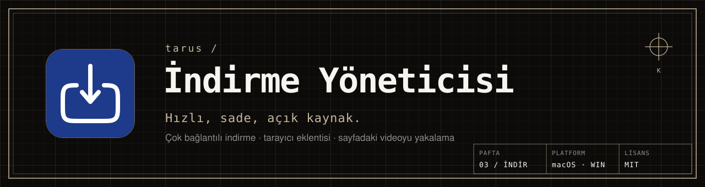
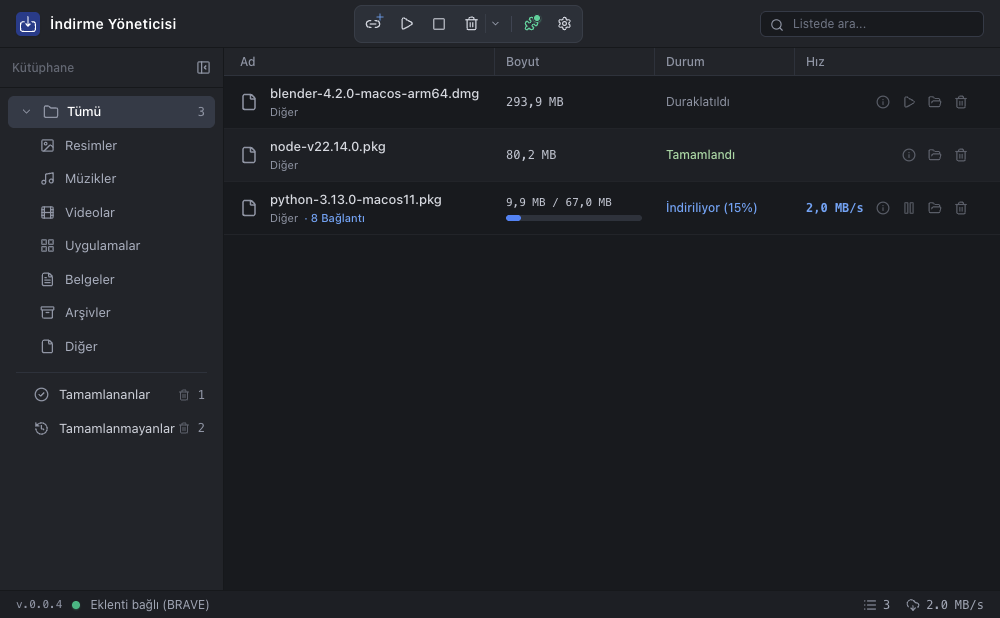
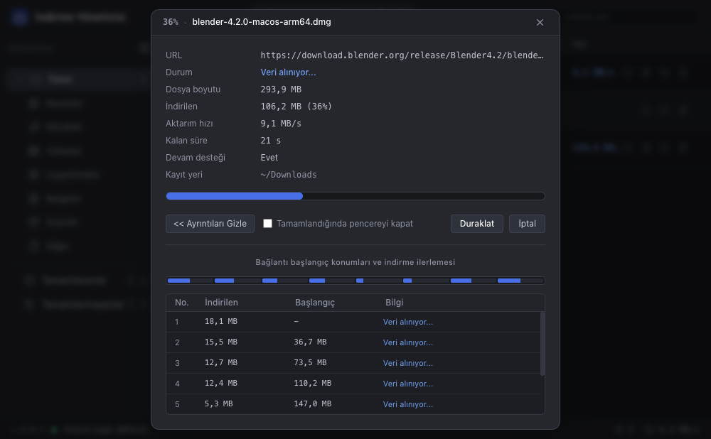
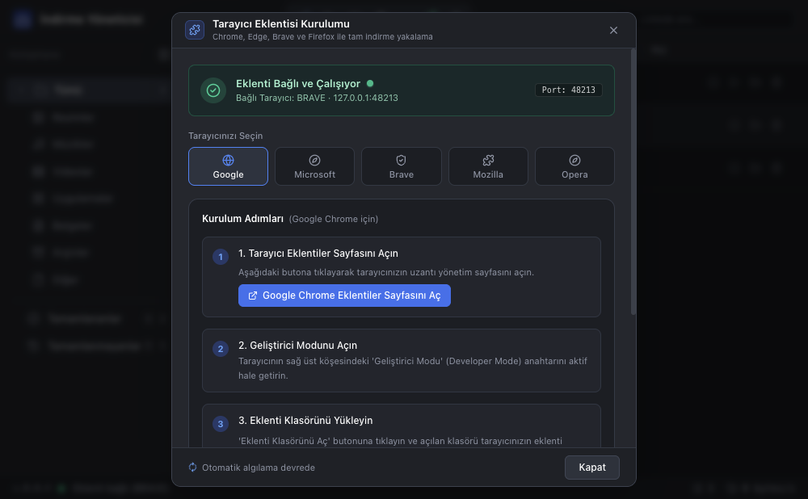

<picture>
  <source media="(prefers-color-scheme: dark)" srcset="docs/readme/afis-koyu.svg">
  <source media="(prefers-color-scheme: light)" srcset="docs/readme/afis-acik.svg">
  
</picture>

<p align="center">
  <a href="LICENSE"></a>
  
  <a href="https://github.com/tarusatolye/indirme-yoneticisi/releases/latest"></a>
</p>

**İndirme Yöneticisi**, macOS ve Windows için hızlı ve sade bir indirme aracıdır. Tarayıcıdaki indirmeleri yakalar, dosyayı parçalara bölüp aynı anda indirir, yarıda kalanı kaldığı yerden sürdürür.



<table>
  <tr>
    <td width="50%"></td>
    <td width="50%"></td>
  </tr>
  <tr>
    <td align="center"><sub><b>01</b> · İLERLEME</sub></td>
    <td align="center"><sub><b>02</b> · EKLENTİ</sub></td>
  </tr>
</table>

### ◢ Ne yapar

- **Çok bağlantılı indirme:** dosyayı parçalara bölüp aynı anda indirir (varsayılan 8, 1–16 arası).
- **Duraklat ve sürdür:** bağlantı kopsa ya da uygulama kapansa da indirme kaldığı yerden devam eder.
- **Tarayıcı eklentisi:** Chrome, Edge, Brave ve Firefox indirmelerini yakalar; çerez ve yönlendiren bilgisini aktarır.
- **Video yakalama:** sayfadaki video ve ses akışlarını yt-dlp ve FFmpeg ile MP4 olarak indirir.
- **Kategoriler:** resim, müzik, video, uygulama, belge ve arşivleri kendiliğinden ayırır.
- **Yerel çalışır:** indirme geçmişi ve dosyalar bilgisayarınızda kalır; eklentiyle iletişim yalnız bu bilgisayar üzerindendir.

### ◢ Kurulum

[**Son sürümü indir →**](https://github.com/tarusatolye/indirme-yoneticisi/releases/latest)

| Sistem | Dosya |
|---|---|
| macOS | `Indirme-Yoneticisi-<sürüm>-mac.dmg`: açın, uygulamayı *Uygulamalar* klasörüne sürükleyin |
| Windows | `Indirme-Yoneticisi-Setup-<sürüm>.exe` kurulum ya da `…-portable.exe` kurulumsuz |

**Tarayıcı eklentisi:** uygulamada üst çubuktaki yapboz düğmesine basın, tarayıcınızı seçin ve adımları izleyin (eklentiler sayfasında Geliştirici Modu açılır, eklenti klasörü sürüklenir). Eklenti bağlanınca alt çubuktaki gösterge yeşile döner.

<details>
<summary><b>Kaynaktan derleme</b></summary>

Node.js 20 ya da üstü gerekir.

```bash
npm install
npm start            # uygulamayı çalıştırır
npm run dist:mac     # macOS: DMG ve ZIP
npm run dist:win     # Windows: kurulum ve taşınabilir exe
```

</details>

### ◢ Lisans ve atıf

[MIT](LICENSE) © 2026 tarusatolye. Video indirme için [yt-dlp](https://github.com/yt-dlp/yt-dlp) ve [FFmpeg](https://ffmpeg.org) kullanılır; her biri kendi lisansıyla dağıtılır.

İndirme Yöneticisi genel amaçlı bir araçtır. İndirilen içeriğin telif ve kullanım koşullarına uygunluğundan kullanıcı sorumludur.

---

<details>
<summary><b>English</b></summary>

**İndirme Yöneticisi** (Download Manager) is a fast, simple download manager for macOS and Windows. It catches browser downloads (Chrome, Edge, Brave, Firefox), splits files into parallel segments, resumes interrupted downloads and saves page videos via yt-dlp and FFmpeg. Everything stays on your computer. Get it from [Releases](https://github.com/tarusatolye/indirme-yoneticisi/releases/latest). MIT licensed.

</details>

<p align="center"><sub><a href="https://tarus.tr">tarus.tr</a> · <a href="mailto:destek@tarus.tr">destek@tarus.tr</a> · PAFTA 03 · İNDİR · ÇARŞAMBA, SAMSUN</sub></p>
